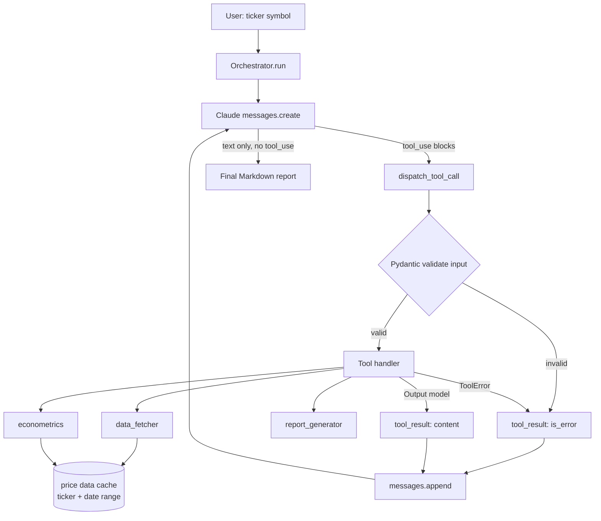

# EconoAgent

[](https://github.com/basartuncay/EconoAgent/actions/workflows/ci.yml)

EconoAgent is an autonomous econometric research agent built on Claude's tool-use API. Given a ticker symbol, it decides on its own which tools to call and in what order — fetching price data, computing descriptive statistics, fitting an ARMA-EGARCH volatility model — and produces a Markdown analysis report.

## Architecture

The agent is a thin loop, not a hardcoded pipeline: `Orchestrator.run()` sends the ticker to Claude with four registered tools and just keeps feeding tool results back until Claude stops calling tools and returns final text. Claude — not the code — decides whether to run summary statistics, fit a volatility model, both, or retry after a failure.

- **`orchestrator.py`** — owns the agent loop and the `ToolSpec` registry (name, JSON tool definition, Pydantic input model, handler). It validates every `tool_use.input` against the tool's input model before dispatch, catches handler exceptions and `ToolError`s, and converts both into `tool_result` blocks so a single bad call never crashes the run.
- **`tools/data_fetcher.py`** — fetches historical OHLCV bars for a ticker via `yfinance`. Exposes both a plain and a cached (`fetch_price_data_cached`) entry point.
- **`tools/econometrics.py`** — `compute_summary_statistics` (mean/annualized return, volatility, Sharpe, skew, kurtosis, max drawdown) and `fit_volatility_model` (ARMA mean equation via `statsmodels`, EGARCH variance equation via `arch`). Both pull price data through the shared cache instead of taking raw bars as tool input.
- **`tools/report_generator.py`** — renders the computed statistics and (optional) fitted model into a Markdown report.
- **`models/schemas.py`** — the single source of truth for every tool's input/output shape. The orchestrator validates against these on the way in and the way out.



Each turn appends the assistant's response and the tool results to the running `messages` list and calls Claude again, until a turn produces text with no `tool_use` blocks (or `max_iterations` is hit, which raises rather than silently truncating).

## Design Decisions

**Manual agentic loop instead of the SDK's `tool_runner`.** The loop is hand-rolled in `Orchestrator.run()`/`_dispatch_tool_call()` rather than using `client.beta.messages.tool_runner`. This keeps input/output validation, retry/fallback behavior on a per-tool failure budget, and the iteration cap fully under our control and directly unit-testable against a mocked `anthropic.Anthropic` client — no need to spin up the SDK's own loop internals to test our error-handling paths.

**Ticker+date-range cache instead of passing OHLCV back through the model.** `data_fetcher.fetch_price_data_cached` memoizes on `(ticker, start_date, end_date, interval)`. `compute_summary_statistics` and `fit_volatility_model` both fetch through this cache internally rather than taking raw price points as tool input. Without it, either Claude would have to round-trip full OHLCV series through its own context window between tool calls (expensive, and a real limit on how much history the agent can reason over), or every tool would re-hit `yfinance` for the same range. The cache lets multiple tools reuse one fetch within a run while keeping the tool-call surface to just a ticker and a date range.

**Strict Pydantic validation (`extra="forbid"`) on every tool input.** `ToolInputModel` rejects unexpected fields instead of silently dropping them. The tool JSON schemas sent to Claude already set `additionalProperties: False`, but that only constrains what the model is *instructed* to send — `extra="forbid"` is the belt-and-suspenders check on the actual dict that comes back, so a stale or mistyped field fails loudly instead of being ignored. This turned out to matter in practice — see below.

## Testing & Lessons Learned

Two real bugs surfaced while writing tests, both worth calling out:

1. **Pydantic was silently swallowing extra fields, letting a test slip through to a real network call.** Before `ToolInputModel` set `extra="forbid"`, a test constructing `FetchPriceDataInput` with a typo'd field name validated successfully anyway (Pydantic's default is to ignore unknown keys), so the test's mock never intercepted the call it was supposed to and `yfinance` got hit for real. Making `extra="forbid"` the default across every input model turned that class of typo into an immediate `ValidationError` instead of a flaky, network-dependent test.

2. **The EGARCH optimizer didn't converge under its default iteration limit.** `arch_model(...).fit()` was failing `convergence_flag` checks on some fixture series under the library's default `maxiter`. Raising it explicitly to `options={"maxiter": 500}` (see `tools/econometrics.py`) fixed convergence on the test fixtures without changing the fitted model's specification.

All 25 tests pass locally and in CI (GitHub Actions, see badge above). Tests mock the `yfinance` and Anthropic API boundaries — no real network calls or API keys are needed to run the suite.

## Setup & Usage

```bash
# clone and install
git clone https://github.com/basartuncay/EconoAgent.git
cd EconoAgent
pip install -e ".[dev]"

# configure your API key
cp .env.example .env
# then edit .env and set:
# ANTHROPIC_API_KEY=sk-ant-...
```

Run the agent:

```bash
econoagent
# or: python -m src.agent.orchestrator
```

You'll be prompted for a ticker symbol; the agent runs its tool-use loop and prints the resulting Markdown report.

Run the test suite:

```bash
pytest -v
```

## Tech Stack

- Python 3.11
- Anthropic SDK (Claude tool use)
- Pydantic v2
- yfinance
- statsmodels (ARMA)
- arch (EGARCH)
- pytest / pytest-mock / pytest-cov
- GitHub Actions (CI)

## Future Work

Not yet implemented — noted here as honest scope, not a roadmap commitment:

- **Sentiment/news analysis integration** — incorporating news or sentiment signals alongside the purely price-based statistics and volatility model.
- **Real-time data streaming** — the agent currently works over historical bars fetched once per run; there's no live/streaming price feed.
- **Web interface** — usage today is CLI-only (`econoagent`); no web UI exists yet.

## License

MIT — see [LICENSE](LICENSE).
